# Eat & Fit

### Your workouts, food, and AI coach—connected in one private, installable app.

[**Try Eat & Fit →**](https://eatand.fit)

Eat & Fit turns the daily fitness loop into one simple experience: choose what to train, follow the workout, understand your movement, find or create food, log what you eat, and see how the whole day balances out.

It is designed for people who want useful guidance without creating another account or sending their entire fitness history to the cloud. Your profile, calendar, meals, and workout history stay in your browser. AI is applied only where it adds real value: planning, ingredient recognition, recipe creation, energy personalization, and optional post-set movement review.

<p align="center">
  <a href="docs/screenshots/balance-gauge.png">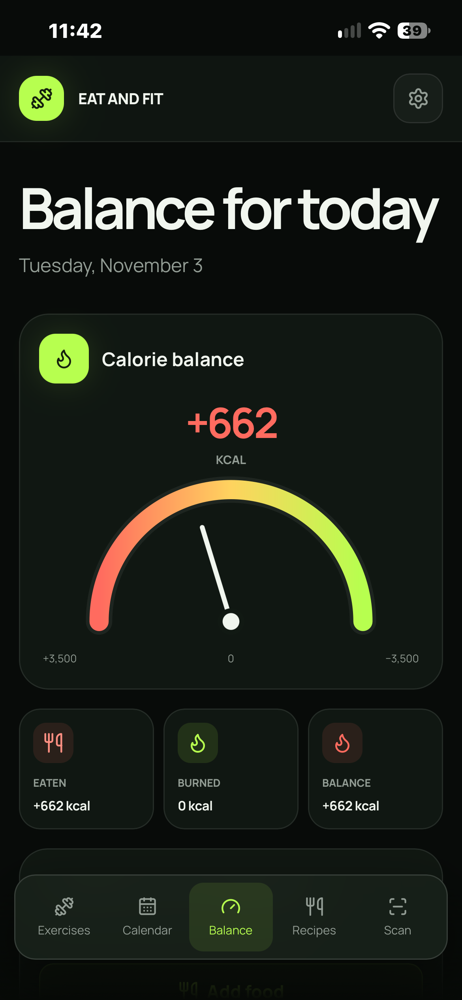</a>
  <a href="docs/screenshots/exercise-library.png">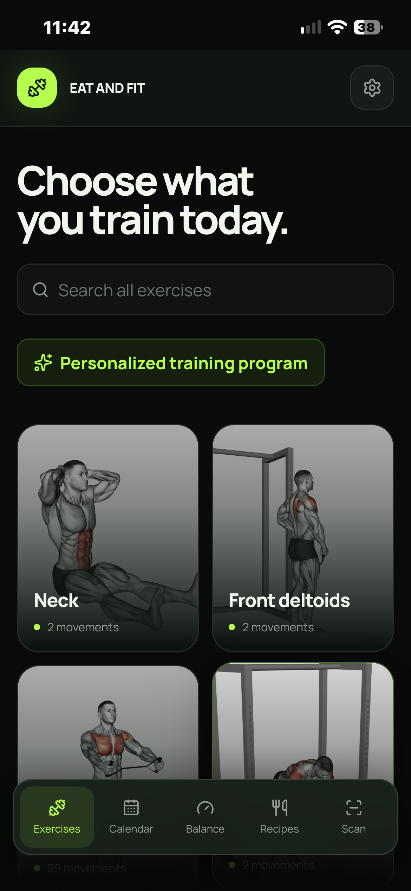</a>
  <a href="docs/screenshots/recipe-search.png">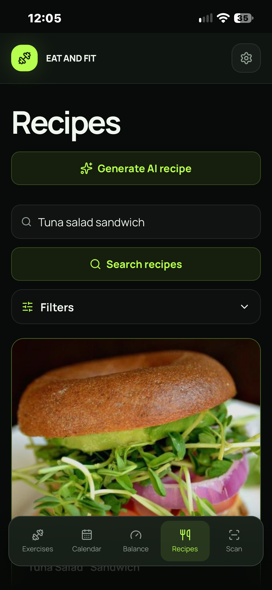</a>
</p>

## Why Eat & Fit is different

- **One continuous journey.** Exercises, meals, scanning, nutrition, and calorie balance are not isolated tools. Every action can flow into the Calendar and immediately update the day.
- **AI that supports decisions.** Meta models help recognize ingredients, create recipes, plan two weeks of training, personalize adult energy estimates, and review recorded exercise sets.
- **Fast local coaching.** Supported exercises use on-device pose tracking for immediate repetition counting and deterministic movement cues—without waiting for a cloud response.
- **Privacy by design.** There are no user accounts and no cloud fitness profile. Camera review and AI submission happen only after a clear user action.
- **Real data, not a demo catalog.** Eat & Fit includes 317 exercises, 39,447 recipes, 13,694 USDA foods, and more than one million normalized nutrient values.
- **Built for the phone.** It is a responsive Progressive Web App that can be installed on iPhone, Android, and desktop.

## What you can do

### 1. Personalize the experience—without creating an account

A short, skippable setup asks for age, sex, weight, and height. These values select matching exercise demonstrations and improve age-appropriate energy estimates. The profile remains in the current browser and can be changed later in Settings.

<p align="center">
  <a href="docs/screenshots/onboarding.png">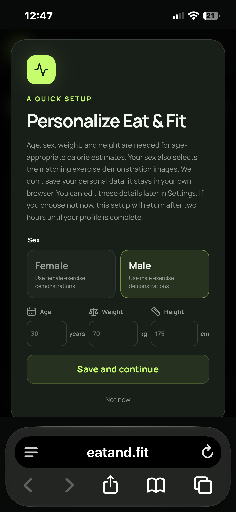</a>
</p>

### 2. Find the right exercise or generate a two-week plan

Browse the exercise library by muscle group, search by name, or ask Meta AI to create a personalized two-week program from your profile and goal. Generated plans use exercises that actually exist in the Eat & Fit catalog, default to three sessions per week, and remain editable before they are added to the Calendar.

Every exercise includes demonstration media, instructions, form cues, common mistakes, breathing guidance, equipment, sets, repetitions, weight, and duration. Calendar controls also make it practical to move future training when life changes.

<p align="center">
  <a href="docs/screenshots/exercise-library.png"></a>
  <a href="docs/screenshots/workout-calendar.png">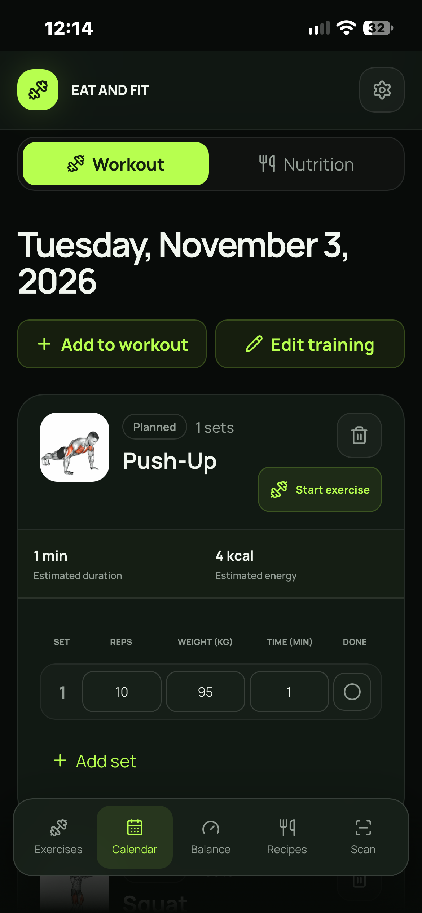</a>
</p>

### 3. Train with camera-guided feedback

For validated movements, MediaPipe Pose Landmarker runs locally to follow body landmarks, count repetitions, and provide immediate deterministic cues. The live counter remains authoritative and responsive even before any cloud analysis is requested.

After a set, an adult user can explicitly choose **Analyze with AI**. Meta SAM 3.1 checks and tracks the athlete in the recorded set, while Muse Spark 1.3 reviews the movement evidence, observes the repetition count, and produces one focused coaching recommendation. If Muse observes a different count, Eat & Fit shows both results and lets the user decide—AI never silently rewrites workout history.

Unsupported exercises can still be completed with a timer or recorded for provider-based review. Local workout progress is preserved even if an AI request fails.

<p align="center">
  <a href="docs/screenshots/exercise-coaching.png">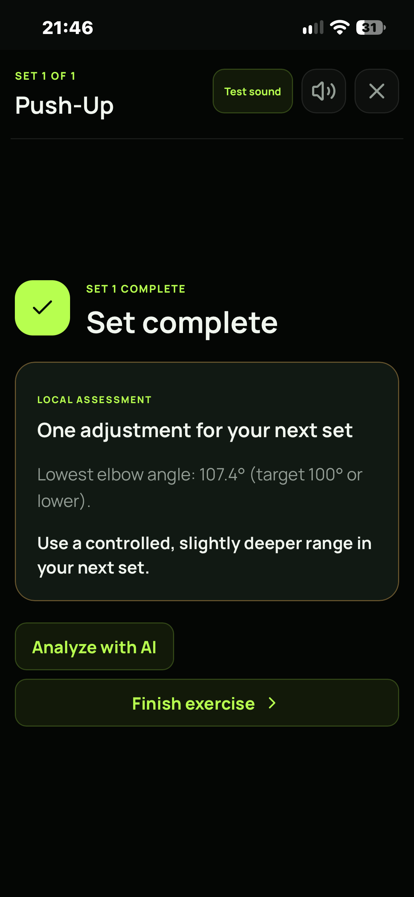</a>
</p>

### 4. Discover food that fits the day

Search the complete 39,447-recipe DataHive catalog with autocomplete and filters, browse daily suggestions, or generate two recipes with AI from ingredients and dietary preferences. Recipe details include ingredients, classifications, nutrition, source information, serving adjustment, and a direct handoff to Calendar.

AI-generated recipes can be checked ingredient by ingredient against the local USDA FoodData Central database before saving. The user always reviews the selected foods, gram amounts, and final nutrition result.

<p align="center">
  <a href="docs/screenshots/recipe-search.png"></a>
  <a href="docs/screenshots/recipe-detail.png">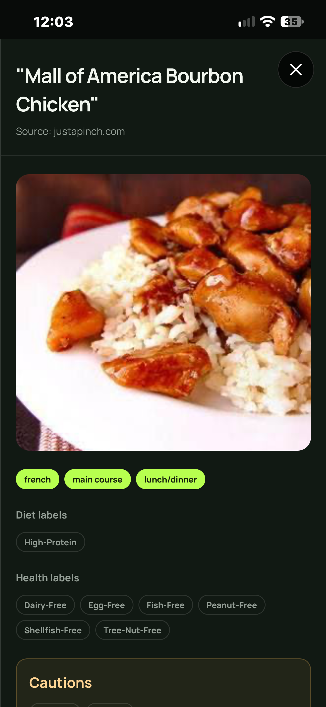</a>
</p>

### 5. Turn a camera into a kitchen shortcut

Smart Scan accepts a food photo containing multiple ingredients, lets the user correct the recognized list, and sends the result to recipe search or AI recipe generation. The barcode mode reads supported retail barcodes with the rear camera and looks up packaged-food information through Open Food Facts. Manual barcode entry remains available when camera access is unavailable.

<p align="center">
  <a href="docs/screenshots/barcode-scanner.png">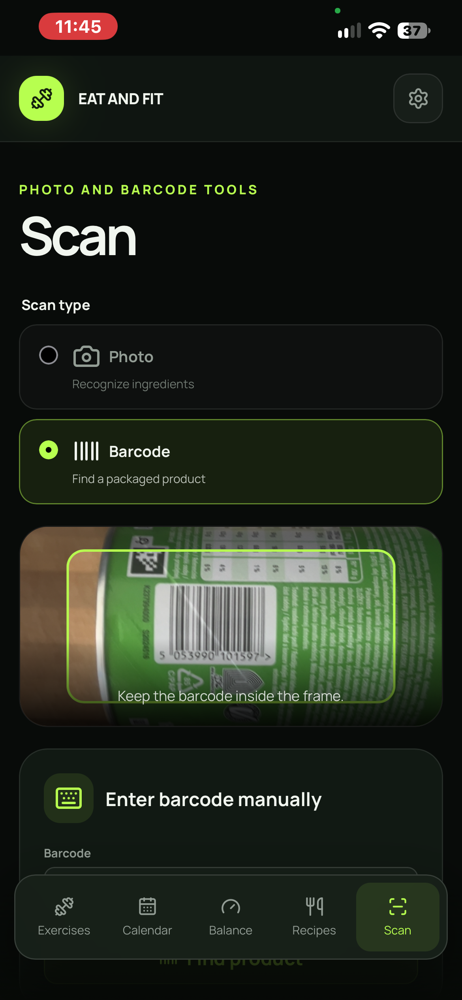</a>
</p>

### 6. Keep workouts and nutrition in one Calendar

Calendar is the source of truth for planned workouts, completed sets, recipes, AI-created meals, and scanned products. Exercise and food cards open their full details, while edits immediately update daily totals.

<p align="center">
  <a href="docs/screenshots/workout-calendar.png"></a>
  <a href="docs/screenshots/nutrition-calendar.png">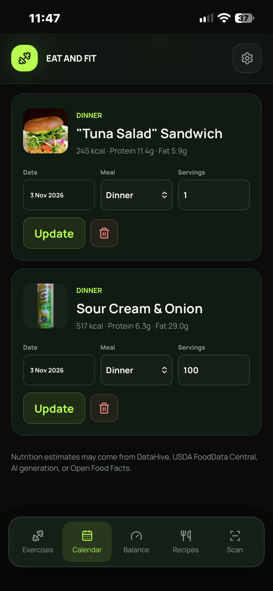</a>
</p>

### 7. Understand today at a glance

Balance is the default screen. Its gauge combines food calories with calories from completed exercise, while the seven-day chart shows how the pattern changes over time. Planned workouts do not count as burned calories until they are completed.

From the same screen, **Add food** opens Recipes and **Add exercise** opens the exercise library, so the next action is always one tap away.

<p align="center">
  <a href="docs/screenshots/balance-gauge.png"></a>
  <a href="docs/screenshots/balance-actions.png">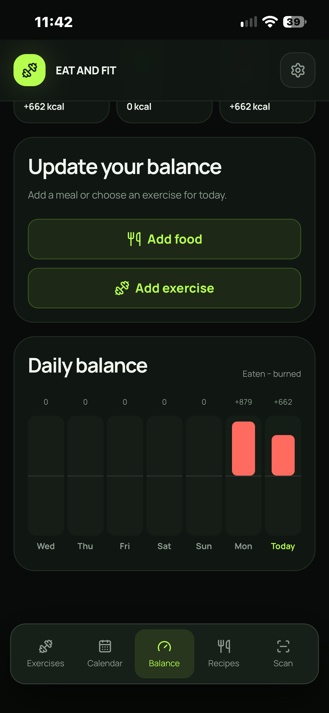</a>
</p>

## Navigation

| Destination | What it is for |
| --- | --- |
| **Exercises** | Browse 317 movements, search exercises, inspect technique, generate a program, and schedule training. |
| **Calendar** | Plan and complete workouts, edit sets, manage future training, and review logged food. |
| **Balance** | See today's eaten, burned, and net calories plus the rolling seven-day view. This is the default screen. |
| **Recipes** | Search 39,447 recipes, use filters and suggestions, generate recipes with AI, and check nutrition with USDA. |
| **Scan** | Recognize multiple ingredients from a photo or scan a packaged-product barcode. |
| **Settings** | Edit the local profile, manage optional personal AI credentials, export or restore history, read legal notices, and delete local data. |

On mobile, the five primary destinations stay in the bottom navigation. Settings is always available from the gear icon in the header.

## Two complete user journeys

### From “I want to train” to measurable progress

1. Complete the private profile or skip it for later.
2. Search for an exercise or generate a personalized two-week program.
3. Review dates and sessions, then save them to Calendar.
4. Start today's exercise with local camera tracking or the set timer.
5. Optionally ask SAM 3.1 and Muse Spark 1.3 to review the finished set.
6. Confirm the final repetition count and see completed energy appear in Balance.

### From “What can I eat?” to a logged meal

1. Search the catalog, scan ingredients, or scan a product barcode.
2. Open a trusted catalog recipe or generate two ideas with AI.
3. Review ingredients, servings, nutrition, and optional USDA calculations.
4. Save the meal to a date and meal period in Calendar.
5. See the meal reflected immediately in the daily Balance.

## How Meta makes the experience better

Eat & Fit uses Meta models as part of a deliberate hybrid system rather than asking one model to do everything.

| Capability | Responsibility |
| --- | --- |
| **Muse Spark 1.3** | Recognizes multiple ingredients, generates structured recipes, creates adult training plans, calibrates estimates, and turns measured movement evidence into concise coaching. |
| **SAM 3.1** | Verifies and tracks one athlete through an explicitly submitted post-set video so coaching is grounded in the intended person. |
| **MediaPipe Pose Landmarker** | Runs locally for low-latency body landmarks, joint angles, movement state, and authoritative repetition counting on supported exercises. |
| **Eat & Fit rules** | Validate every structured response, enforce age and confidence boundaries, preserve local results, and require confirmation before an AI-observed count changes Calendar. |

This separation creates a stronger experience: instant local feedback during movement, richer Meta reasoning after the set, visible evidence, and a safe fallback when connectivity or inference is unavailable. A correct set can receive positive confirmation; the product does not invent a mistake merely to produce coaching.

## Privacy users can understand

- No account is required.
- Profile, workouts, meals, saved products, and history stay in browser storage.
- JSON backup and complete local-data deletion are available in Settings.
- Camera video and landmarks are not added to backups or analytics.
- Movement video is submitted only after separate consent for that set and temporary files are cleaned up after analysis.
- The hackathon build provides Meta features through a server-held credential that is never delivered to the browser.
- A user may save an optional personal Meta key. It is encrypted locally and takes priority until removed.
- AI results and fitness estimates are presented for review and are not medical advice.

<p align="center">
  <a href="docs/screenshots/ai-settings.png">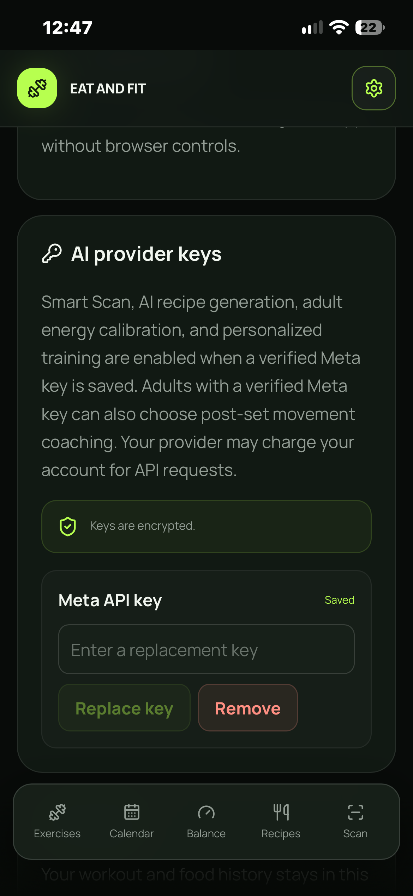</a>
</p>

## Install it like an app

Eat & Fit is a PWA. On iPhone, open [eatand.fit](https://eatand.fit) in Safari, tap **Share**, and choose **Add to Home Screen**. Android browsers offer **Install app** or **Add to Home screen** from the browser menu. The installed experience uses the full screen without browser chrome and keeps the same local data model.

## Free editions

| Feature | Core | AI / hackathon edition |
| --- | :---: | :---: |
| Exercise catalog, Calendar, Balance, recipes, USDA, barcode lookup | ✓ | ✓ |
| Local camera tracking and set timers | ✓ | ✓ |
| Ingredient-photo recognition | — | Meta |
| AI recipe generation | — | Meta |
| Personalized adult training plans and energy calibration | — | Meta |
| Optional SAM/Muse post-set review | — | Meta |
| Optional encrypted personal-key override | — | ✓ |

The Core edition contains every feature that does not require model inference. Gemini adapters remain available behind configuration boundaries for future use, but Gemini is disabled in the current hackathon deployment and there is no automatic provider fallback.

---

## Technical overview

Eat & Fit is an English-language React and TypeScript PWA backed by a small Node.js API and read-only SQLite catalogs. IndexedDB stores browser-local profile and history data. Docker Compose and Nginx provide production packaging and routing.

```text
Browser / installed PWA
├── React + TypeScript interface
├── IndexedDB profile, Calendar, products, and history
├── MediaPipe local pose worker
└── Service worker application and exercise-poster cache
        │
        ▼
Same-origin Node.js API
├── DataHive recipe SQLite service
├── USDA FoodData Central SQLite service
├── Open Food Facts product lookup
└── Restricted Meta transport in the AI edition
        ├── Muse Spark 1.3
        └── SAM 3.1
```

### AI credential modes

The centralized application configuration supports these deployment modes:

- `none`: Core edition; AI routes and controls are unavailable.
- `server`: the deployment supplies a server-held credential and hides personal-key setup.
- `byok`: inference requires an encrypted device-local user key.
- `hybrid`: the hackathon default; the server credential works without setup, while an optional personal key takes priority for that browser.

The server credential is mounted as a read-only Docker secret, copied into container tmpfs with node-only permissions, and never compiled into JavaScript, returned by an API, stored in browser data, or written to logs. A failing personal-key request never silently falls back to the shared key.

AI recipe-photo generation is disabled in current builds. Generated recipes use bundled category illustrations or the standard placeholder. Firebase Analytics is optional and remains disabled when its public configuration is absent.

## Local development

Requires Node.js 24+, Python 3.12+, and separately obtained DataHive and USDA source files for the normal import workflow.

```bash
npm install
cp .env.example .env
python3 recipe-import/import_recipes.py /path/to/recipes.csv data/recipes.sqlite
python3 nutrition-import/import_usda.py /path/to/usda-csv data/nutrition.sqlite
npm run api
npm run dev
```

If the original USDA CSV directory is unavailable, the recovery importer downloads pinned public Foundation Foods, SR Legacy, and FNDDS releases and rebuilds the normalized database without an API key:

```bash
python3 nutrition-import/recover_usda.py
```

Use `--cache-dir`, `--output`, `--source`, or `--force` to override its local defaults.

### Build editions

```bash
npm run build          # Core -> dist/
npm run build:byok     # AI/BYOK -> dist/
npm run build:editions # Both -> dist/core and dist/byok
```

For device-key-only development, set `AI_CREDENTIAL_MODE=byok` and use `npm run api:byok` with `npm run dev:byok`. Provider secrets do not belong in `.env`, source files, build arguments, or images.

### Shared hackathon deployment

```bash
install -d -m 700 secrets
install -m 600 /secure/path/meta_api_key secrets/meta_api_key
APP_EDITION=byok AI_CREDENTIAL_MODE=hybrid \
  docker compose -f compose.yaml -f compose.shared-ai.yaml up -d --build api web
```

Recipe and nutrition databases live in named Docker volumes, so application image replacement does not remove catalog data.

## Verification

```bash
python3 scripts/validate_exercise_catalog.py
npm test
npm run typecheck
npm run build
npm run build:byok
docker compose config
```

Production health endpoints include `/healthz`, `/api/recipes/healthz`, `/api/nutrition/healthz`, and AI provider health routes in the AI edition.

## Data sources, licenses, and safety

- Exercise data and demonstrations are attributed to [free-exercise-db-api](https://github.com/luisaraujoc/free-exercise-db-api), which declares an MIT license. Confirm rights to externally hosted media separately before commercial reuse.
- The [DataHive recipes-with-nutrition dataset](https://huggingface.co/datasets/datahiveai/recipes-with-nutrition) is licensed CC BY-NC 4.0. Its 39,447 recipes are used only for this non-commercial project. Linked source pages and images can have separate owners and terms.
- [USDA FoodData Central](https://fdc.nal.usda.gov/) data is public domain and published under CC0 1.0.
- Packaged-product data comes from [Open Food Facts](https://world.openfoodfacts.org/terms-of-use) and can be incomplete or outdated.
- Adult estimates cite the [2024 Adult Compendium of Physical Activities](https://pacompendium.com/conditioning-exercise/). Ages 60+ prefer the [Older Adult Compendium](https://pacompendium.com/older-adult-compendium/). Ages 6–18 use the [Youth Compendium](https://www.nccor.org/tools-youthcompendium/met-view-by-individual-category/) and its published Schofield equations.
- [Harvard Health's 30-minute table](https://www.health.harvard.edu/diet-and-weight-loss/calories-burned-in-30-minutes-for-people-of-three-different-weights) provides an interpolated fallback and regression reference.
- Local movement landmarks use [MediaPipe Pose Landmarker](https://ai.google.dev/edge/mediapipe/solutions/vision/pose_landmarker). Optional movement evidence and coaching use [Meta SAM 3.1](https://dev.meta.ai/docs/sam/overview) and [Muse Spark 1.3](https://dev.meta.ai/docs/video-understanding).
- Exercise, nutrition, and AI-generated information is educational, may be incorrect, and is not medical advice. Stop exercising if you experience pain and consult a qualified professional when appropriate.

Source datasets, downloaded media, credentials, environment files, and generated SQLite databases are intentionally excluded from Git.
